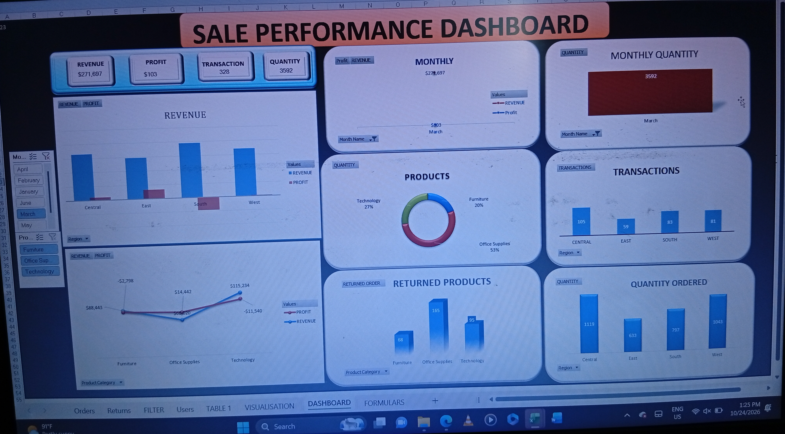

# us-superstore-business-analysis-excel
Interactive Excel workbook and analysis on the US Superstore dataset. Evaluates regional revenue, monthly order trends, producut return rates by category, and overall profitability.
# 📊 US Superstore Sales & Performance Analysis (Excel)

An end-to-end exploratory data analysis and interactive executive dashboard built using **Microsoft Excel** to evaluate revenue, profitability, regional trends, and product return rates for the US Superstore dataset.

---

## 📸 Executive Dashboard Preview



---

## 📌 Project Overview

This project analyzes historical transactional data from the US Superstore to identify key business drivers, operational bottlenecks, and regional performance metrics. The goal is to provide actionable commercial insights into revenue growth, product profitability, demand seasonality, and product return patterns.

---

## 🎯 Key Analytical Focus Areas

* **Financial Performance:** Tracking total revenue, net profit, and gross margins across order cohorts.
* **Regional Breakdown:** Evaluating monthly revenue, sales volume (quantity), order volume (transactions), and unit demand across geographical regions.
* **Product Performance:** Identifying top-performing product categories, sub-categories, and items by sales volume and profitability.
* **Return Rate Analysis:** Assessing product returns across product categories to pinpoint high-friction inventory.

---

## 🛠️ Tools & Excel Features Used

* **Data Cleaning & Transformation:** Power Query / Advanced Data Formatting (handling duplicates, missing values, and date parsing).
* **Data Modeling & Formulas:** Dynamic array functions, `XLOOKUP`, `INDEX/MATCH`, `SUMIFS`, `COUNTIFS`, `GETPIVOTDATA`, and calculated fields.
* **Aggregation & Summarization:** PivotTables and PivotCharts for multi-dimensional data grouping.
* **Visualization & UX:** Custom KPI cards, conditional formatting, slice-and-dice timeline slicers, and interactive dashboard layouts.

---

## 💡 Key Business Insights

1. **Regional Demand Dynamics:** 
   * *The East region drove the highest overall revenue, with peak sales occurring during Q2.*
2. **Category Profitability vs. Volume:** 
   * *Technology products yielded the highest profit margins, while month of April generated the highest profit.*
3. **Product Returns Mitigation:** 
   * *Product return rates were highest in the Office Supplies, while the highest transaction came from the Central *

---

## 📂 Repository Structure

```text
us-superstore-excel-analytics/
├── data/
│ └── raw_superstore_data.xlsx # Original dataset
├── dashboards/
│ └── superstore_analysis.xlsx # Main Excel workbook with PivotTables & Dashboard
├── screenshots/
│ ├── dashboard_overview.png # Screenshot of the main dashboard
🚀 How to View & Use the Project
​Download the Workbook: Navigate to the dashboards/ folder and download superstore_analysis.xlsx.
​Open in Microsoft Excel: Open the file using Microsoft Excel 2016 or newer (or Excel for Web) to ensure full compatibility with dynamic array formulas and interactive slicers.
​Interact with the Dashboard: Use the built-in region and category slicers to filter KPIs, charts, and table metrics dynamically.
​👤 Author
​Developer: Chinedu Ugwu
​GitHub: @davecodes-ux
​If you found this analysis insightful or useful for your own project reference, feel free to give this repository a ⭐️!
└── README.md #
